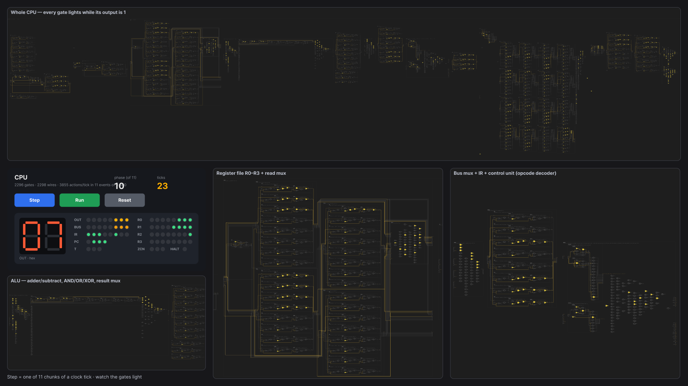
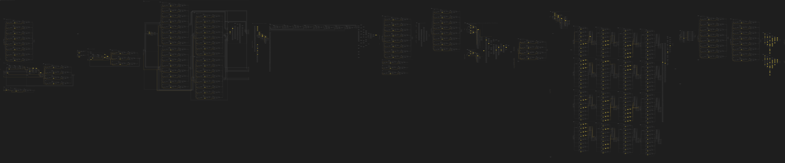
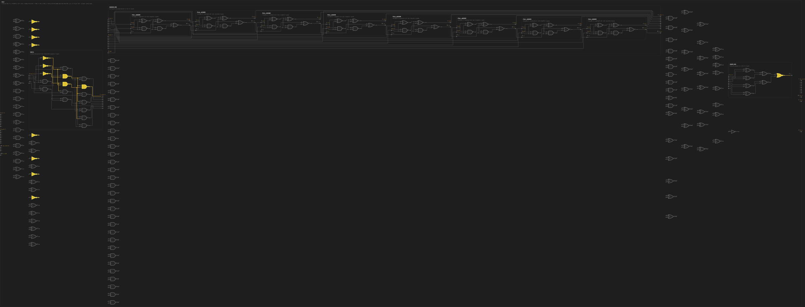
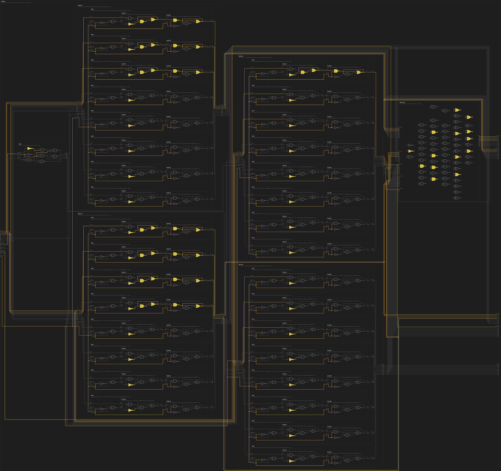
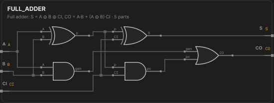

# Two Figma

**A computer built from logic gates that Figma's prototype engine computes, running a Figma editor inside Figma.**

There's no code at run time. You open the file, press **Present**, and Figma runs the computer.



> In Figma, a prototype variable can be set to an expression like `a AND NOT b`, and that is a logic gate. With enough gates you can build a computer. We wanted to see how far that goes: can Figma Design run a CPU, and can that CPU run Figma?

---

## What's in it

|                           |                                                                                                                                                                                                                                                                               |
| ------------------------- | ----------------------------------------------------------------------------------------------------------------------------------------------------------------------------------------------------------------------------------------------------------------------------- |
| **Gate-level CPU**        | An 8-bit processor made of **~2,300 two-input gates**. Every wire is a Figma boolean variable and every gate is one `SET_VARIABLE` prototype action. In Present mode it runs real programs: counting, multiplication, Fibonacci, pointer loads/stores and a small perceptron. |
| **Figma OS**              | A Figma editor that runs in Present mode, with a toolbar, menus, ⌘K, drawing, move, resize, nudge, duplicate, delete, recolour, strokes and shadows. Its behaviour is a **31,554-gate circuit**, so every click is computed by gates.                                         |
| **Live view**             | Watch the machine work, from the program down to individual gates. Gate layers are bound to the same variables they compute, so they light up as the CPU runs.                                                                                                                |
| **Make lab, live-linked** | A Figma Make app (the Silicon CPU Lab, three.js) runs the same netlist and follows the Present-mode CPU **tick for tick** from another laptop, matching all 2,298 wires on every tick.                                                                                        |

## How Figma becomes hardware

| Hardware concept | Figma feature                                                                                                                                                           |
| ---------------- | ----------------------------------------------------------------------------------------------------------------------------------------------------------------------- |
| Circuit / chip   | **Component.** A full adder is gate instances, `ADDER_W8` is eight full adders, and so on up to `CPU`                                                                   |
| Port / pin       | **Component text property** that holds a net name. You wire parts in the properties panel                                                                               |
| Wire             | **Boolean variable**, one per net (31,000+ in the OS)                                                                                                                   |
| Gate             | **Prototype action:** `SET_VARIABLE` with an AND / OR / NOT expression                                                                                                  |
| Clock tick       | A chain of actions split across buttons, timed hops and overlays                                                                                                        |
| Display          | **Variable bindings.** Lamps, the 7-segment display, the memory view and the OS screen are layers whose visibility is bound to wires, so drawing costs no extra actions |

**The canvas is the source of truth.** The compiler (the "fab") reads the circuit off the canvas, so if you edit a component in Figma, the machine changes.

### Four Figma products, one machine

- **Figma Design** is where the computer runs.
- **Figma MCP server + an AI agent** draw and wire the machine. The first full CPU went in with one `use_figma` call (463 named nodes), and thousands of prototype reactions were written at 0.3–0.8 s each after plugin writes timed out.
- **Figma Plugin API** provides the build-time dev plugins: Build hardware, Compile, and generating every Figma OS screen.
- **Figma Make** hosts the Silicon CPU Lab, a second live view of the same CPU.

## Engineering around Figma's limits

We measured every limit of the prototype engine and designed around it:

- **~700 actions per click.** The viewer crashes somewhere between 1,700 and 2,500 actions per event, and one CPU tick is ~3,900. Ticks are split into chunks, and the OS chip is built _wide_ (all 8 layers compared in parallel, whole records shifted in one tick) so that no event exceeds 700 actions.
- **No nested conditionals.** Figma rejects a conditional inside another one, so every reaction is flat, one level deep.
- **A slow clock.** Timed hops run at ~0.9/s. Restructuring the clock with overlays took the CPU from **7.6 to ~95 ticks/s**, and Fibonacci went from 59 s to ~5 s.
- **No network in prototypes.** With _Adapt content for screen readers_ turned on, Present mode mirrors visible text into the DOM. A Chrome extension reads the tick counter from that mirror and broadcasts it over Supabase Realtime to the Make lab.
- **Smaller limits.** Number variables can't bind to text, so we use string variables. Held keys don't repeat. The free plan allows 3 pages, so everything lives in frames on one page.

## Verified, not eyeballed

Code exists only at build time, as the fab and the test bench:

- **`RefSim`** (naive iterate-until-stable) and **`FastSim`** (the compiled schedule) run the same netlist that Figma runs and check it tick by tick.
- The OS was written first as a TypeScript reducer (`os-ui`). The gate netlist is **fuzzed in lockstep** against it with random editor events.
- All **61 OS screens** were captured from the running app's DOM and generated into Figma 1:1.
- A **self-test inside the Figma file** passes 120 random editor actions.
- The Make lab is checked to equal silicon's `FastSim` on every wire at every tick (mul, ptrout, fib).

## Repository map

```
silicon/            gate-level CPU: HDL, cell library, compiler, simulators, Figma build tools
  docs/SILICON.md     design rules: clocking, latches, netlist contracts
  docs/figma/         renders and a snapshot of the Figma file
  livetab/            the CPU + Live view in the Figma OS's CPU tab
os-ui/              Figma OS as a TypeScript editor, the behavioural spec
osflow/             compiles the editor into a gate-level chart (24k+ gates) and Figma actions
engine/             a wide 5,110-gate editor netlist: one click = one reaction
figma-live-link/    Chrome extension + Supabase bridge from Present mode to Figma Make
glass-ui/           the Silicon CPU Lab (Figma Make code, three.js)
figma-os-extension/ leila-cpu-extension/ plugin/   build-time Figma plugins
spec/               opcodes, memory map, signals, palette
DEVPOST.md          the full project story
```

## Try it

```sh
# Gate-level CPU in the terminal (the same netlist Figma runs)
cd silicon && npm ci
npm run cpu -- mul        # run a program
npm test                  # simulator and netlist tests

# Figma OS as TypeScript, the spec the gates are checked against
cd os-ui && npm ci && npm run build && python3 -m http.server 5173
# open http://localhost:5173/index.html

# Compile the editor to gates
cd osflow && npm ci && npm run gates && npm test
```

To watch the live link, see [figma-live-link/README.md](figma-live-link/README.md).

## Gallery

|                                                                          |                                                                |
| ------------------------------------------------------------------------ | -------------------------------------------------------------- |
|                          |                    |
| Whole CPU on the canvas                                                  | ALU block                                                      |
|  |  |
| Register file, running                                                   | Full adder, built from gates                                   |

## What's next

- Run Figma OS as a program on the general-purpose CPU, instead of on its own chip.
- More Figma tools in the OS: pen, text, comments, rotation, panning.
- A two-way Make link, so the lab can send input back into the prototype.

---

Built at **Cal Hacks** by the Two Figma team.
