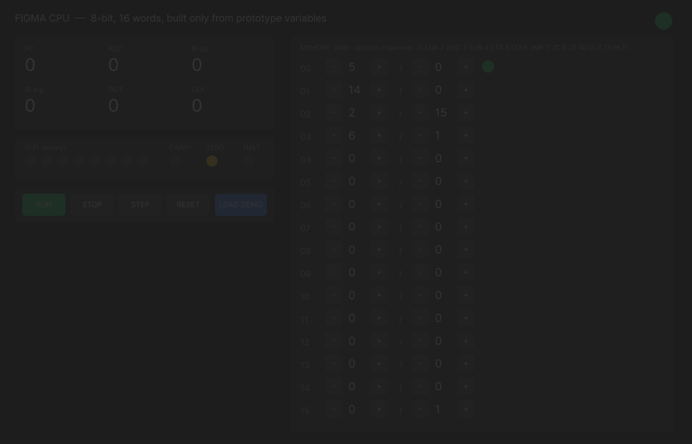
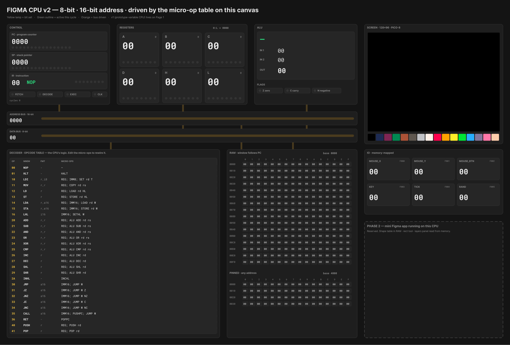

# Stage Log — FigmaCPU

An 8-bit CPU built inside Figma, one reproducible stage at a time.

**How to read this:** every stage is a git tag. `git checkout stage-N` puts the repo exactly where that stage ended. Every entry uses the same template: Goal → Inputs → Figma work → Prompts used → Code → Reproduce → Verify → Gotchas. Screenshots live in [`docs/stages/`](docs/stages/).

**Figma file:** https://www.figma.com/design/l2JmsK7AEQkfo3Cvx67NgN/Untitled
**Tool tags:** `[Design]` Figma Design · `[MCP]` Figma MCP / agent writes · `[Make]` Figma Make · `[Code]` repo code

---

## Stage 0 — v1 CPU from prototype variables + the PRD (tag: `stage-0`)

**Goal:** prove that "a CPU inside Figma" can be built with zero code, and lock the plan for the real build.

**Inputs:** an empty Figma file and the CalHacks track descriptions (Best Figma Workflow, Best Stage Log).

**Figma work:** `[Design]` Page 1 → frame `Main`: registers, flags, controls, and a 16-word memory. Everything is bound to 122 local variables in a `CPU` collection: `pc`, `acc`, `irOp`, `op0…15`, `arg0…15`, `b0…b7`, `at0…15`, and so on. It was built in Figma Design before this log started. Its instruction set is an accumulator machine (`1 LDA · 2 ADD · 3 SUB · 4 STA · 5 LDI · 6 JMP · 7 JC · 8 JZ · 14 OUT · 15 HLT`), preloaded with a counter program.

**Prompts used:**

- Kickoff (verbatim): _"Im trying to create a cpu in figma ask me quesitons to create a prd file documenting how thsi project should actually go …"_
- The interview answers are captured as locked decisions in [PRD.md §3](PRD.md).
- Rescope (verbatim): _"Can you rescope to just CPU and no like figma.com yet? but also create lika visualization rectangle to show where we need add shit -> also a bigger screen would be so muc nicer"_

**Code:** [`PRD.md`](PRD.md), [`tools/layout-slots/`](tools/layout-slots/) (a dev plugin that draws dashed placeholder frames).

**Reproduce:**

1. Open the Figma file → Page 1.
2. Read `PRD.md`.

**Verify:** 

**Gotchas:**

- Prototype variables can _hold_ CPU state, but executing anything needs a conditional branch for every opcode × memory slot. That stops scaling at about 16 words, and the v1 interactions were never wired.
- That limit is the reason for v2: keep the CPU's **logic on the canvas** (as a micro-op table) and move only the "physics" into a plugin.

---

## Stage 1 — One spec to rule them all (tag: `stage-1`)

**Goal:** a single machine-readable definition of the ISA, palette and memory map. The canvas drawing, the assembler and the tests are all generated from or checked against it.

**Inputs:** PRD §6 (ISA) and §8 (memory map).

**Figma work:** none. This stage feeds Stage 2.

**Prompts used:** _"start drawing the entire cpu out try to one shot the PRD. CREATE A PLAN TO ONESHOT THE PRD CPU SPECS"_ → the approved plan locked the open questions:

- palette = PICO-8;
- v2 goes on a new page;
- registers are encoded as `rd<<4 | rs`;
- a fixed micro-op vocabulary.

**Code:**

- [`spec/opcodes.json`](spec/opcodes.json): 29 opcodes, each with `op | mnem | fmt | micro`.
- [`spec/palette.json`](spec/palette.json)
- [`spec/memory-map.json`](spec/memory-map.json)

**Micro-op vocabulary** (the only behavior written in code; everything else is data on the canvas):

| micro-op                                | meaning                                          |
| --------------------------------------- | ------------------------------------------------ |
| `REG`                                   | read the register byte: `rd = b>>4`, `rs = b&15` |
| `IMM8` / `IMM16`                        | read an immediate into `T` / `W` (little-endian) |
| `SET r T` · `COPY r r`                  | register writes                                  |
| `LOAD r HL\|W` · `STORE r HL\|W`        | memory access                                    |
| `SETHL W` · `INCHL`                     | the H:L pointer                                  |
| `ALU op r [r]`                          | ADD SUB AND OR XOR CMP INC DEC SHL SHR           |
| `JUMP W [Z\|NZ\|C\|NC\|N\|NN]`          | control flow                                     |
| `PUSH r` · `POP r` · `PUSHPC` · `POPPC` | stack                                            |
| `HALT`                                  | stop                                             |

FETCH (`IR ← mem[PC]; PC++`) runs before every instruction.

**Reproduce:** `git checkout stage-1 && cat spec/opcodes.json`

**Verify:** `node -e "console.log(require('./spec/opcodes.json').opcodes.length)"` prints `29`.

**Gotchas:** register operands are packed into one byte, so every register instruction has a fixed size. That keeps the two-pass assembler trivial.

---

## Stage 2 — Draw the whole machine with the Figma MCP (tag: `stage-2`)

**Goal:** the complete v2 machine on its own Figma page. Every node the plugin needs carries the contract name from PRD §4.2.

**Inputs:** `spec/*.json` (Stage 1) and a Figma MCP server connected to Claude Code.

**Figma work:** `[MCP]` `[Design]` A new page **Machine v2**. It has components (`Lamp`, and a `Register` set with idle/active variants) and these blocks:

- CONTROL: PC, SP, IR + mnemonic, FETCH/DECODE/EXEC lamps, clock
- REGISTERS: A–L as `Register` instances
- ALU: op, IN1, IN2, OUT, Z/C/N flags
- address and data buses with taps
- **DECODER / OPCODE TABLE**: 29 rows of `op | mnem | fmt | micro`, generated from the spec
- RAM: a 256-byte window that follows PC, plus a 64-byte pinned window
- SCREEN: a 128×96 image-fill target and the PICO-8 palette
- memory-mapped IO
- a dashed Phase 2 slot

The draw added 404 contract-named nodes.

**Prompts used:**

- One-time setup:

  ```bash
  claude mcp add --transport http figma https://mcp.figma.com/mcp
  claude mcp login figma        # needs an interactive terminal
  ```

- The relay prompt is in [`tools/run-in-figma.sh`](tools/run-in-figma.sh). It tells a headless Claude to call `use_figma` with the script file's contents unchanged.

**Code:**

- [`tools/draw-machine/draw.js`](tools/draw-machine/draw.js): the drawing logic.
- [`build.mjs`](tools/draw-machine/build.mjs): injects the spec and emits `code.js` (dev plugin) and `use-figma.js` (MCP body).
- [`tools/run-in-figma.sh`](tools/run-in-figma.sh)

**Reproduce:**

```bash
git checkout stage-2
node tools/draw-machine/build.mjs
tools/run-in-figma.sh tools/draw-machine/use-figma.js "Draw FigmaCPU v2 machine"
```

To replace an existing Machine v2, build with the redraw flag (`build.mjs --force`). Without MCP: Figma desktop → Plugins → Development → Import plugin from manifest → `tools/draw-machine/manifest.json` → run it.

**Verify:** the command prints `RESULT: Drew Machine v2 (…) with 404 contract-named nodes`.


**Gotchas:**

- MCP tools only load when a Claude Code session starts. Adding the server mid-session meant relaying through `claude -p`.
- `use_figma` caps code at 50,000 chars (ours is about 17k).
- Inside `use_figma`, `setPluginData` and `createImageAsync` are forbidden, and pages must be switched with `await figma.setCurrentPageAsync()` + `page.loadAsync()`. The draw script avoids all of these.
- The script is idempotent: it won't redraw over an existing `Machine v2` unless built with the redraw flag.

---

## Stage 3 — The CPU core, assembler and demo programs, tested headless (tag: `stage-3`)

**Goal:** a CPU whose _only_ hard-coded behavior is the micro-op primitives. Instructions come from a decode table, and an assembler targets whatever that table says. Everything is proven with tests before touching Figma.

**Inputs:** `spec/opcodes.json` (Stage 1).

**Figma work:** none.

**Prompts used:** the approved one-shot plan (see Stage 1). No separate prompts; this stage was written directly from the spec.

**Code:**

- [`plugin/src/table.ts`](plugin/src/table.ts): compiles each row's micro-op text (`REG; ALU ADD rd rs`) into functions and validates rows. A bad row becomes an error message, not a crash.
- [`plugin/src/cpu.ts`](plugin/src/cpu.ts):
  - registers, flags and 64 KB of memory;
  - memory-mapped IO (mouse, key, tick, rand);
  - `step()` = fetch → look the opcode up in the table → run its micro-ops;
  - a `Trace` per instruction that later drives the animation.
- [`plugin/src/assembler.ts`](plugin/src/assembler.ts): two-pass, with labels, `.org .db .dw .equ .include`, expressions and `lo()/hi()`. It reports every error with its line number.
- [`plugin/programs/`](plugin/programs/):
  - `count`, `fib`, `rect`, `bounce`, `paint`;
  - `hw.asm` (memory map) and `gfx.asm` (`fill_rect`: `VRAM + y*128 + x` computed with 8-bit registers).
- [`plugin/test/`](plugin/test/): 54 tests:
  - encodings and error messages;
  - each instruction's flags;
  - stack/CALL/RET;
  - IO;
  - each demo program checked against a reference painter;
  - **rewiring ADD→SUB in the table makes `count.asm` count down**.

**Reproduce:**

```bash
git checkout stage-3
cd plugin && npm install && npm test
```

**Verify:** `Tests 54 passed (54)`. In Node the core runs **26–43 million instructions/s**, far above the PRD's 50k Turbo target.

**Gotchas:**

- `bounce.asm` paints a 128×96 background first. That's about 50k instructions before frame 1, so tests and Watch mode need patience there (use Turbo).
- TypeScript 7 no longer auto-includes `@types`/`@figma` type roots, so `tsconfig.json` lists `"types": ["@figma/plugin-typings", "node"]` explicitly.
- `npm install` warns that esbuild's postinstall script is not in `allowScripts`. The binary still resolves through its optional dependency, so the build works anyway.
