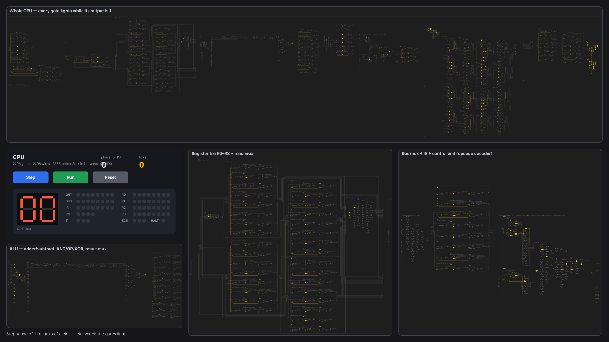

# The Figma side: what's in the file and how it runs

The gate-level CPU lives in the Figma file **testing2**
([open](https://www.figma.com/design/LEOq3pLU5b8Rd10EBFY0Wn/testing2), page **Silicon**; access is through the team
that owns it). Git can't hold a live Figma file, so this folder records it:

- `snapshot.json`: pages, every component and frame with its node id, the Present flows, and every prototype
  reaction (trigger, action counts, expression functions, navigation), read from the file on 2026-10-24.
- `variables.json`: all 2,314 variables (one per wire + 16 controls) with their power-on values for `ptrout`.
  Its fingerprint `508f9676` (FNV-1a over the sorted `name=TYPE:value` lines) matched the file.
- `img/`: renders, idle and mid-run.

The full action lists aren't stored here: they are generated, byte for byte, by `npm run connector:chunks`
(`silicon/tools/connector`, branch `leila/silicon-pointers`), and the same gate actions serve every program.

## 1. The circuit: only gates

8 gate components (`gate/AND OR NOT NAND NOR XOR XNOR BUF`), each with a hidden `lit` layer. Everything else is a
component built from gate instances: 33 cells (latches, flip-flops, registers, muxes, adders, decoders, RAM, ALU,
control unit…) and `cell/CPU`, 2,296 gates, drawn by the plugin's Build hardware and read back from the canvas.

| Block (inside `cell/CPU`) | Render | Node |
|---|---|---|
| ALU: 8-bit ripple adder (subtract via ¬B + 1), AND/OR/XOR, result mux | [img/block-alu.png](img/block-alu.png) | [2001:125594](https://www.figma.com/design/LEOq3pLU5b8Rd10EBFY0Wn/testing2?node-id=2001-125594) |
| Register file R0–R3 + read mux | [img/block-registers.png](img/block-registers.png) | [2001:118036](https://www.figma.com/design/LEOq3pLU5b8Rd10EBFY0Wn/testing2?node-id=2001-118036) |
| Control unit: opcode + T-state decoders, the PLA generated from `spec.ts` | [img/block-control.png](img/block-control.png) | [2001:116259](https://www.figma.com/design/LEOq3pLU5b8Rd10EBFY0Wn/testing2?node-id=2001-116259) |
| RAM: 16 bytes of D-latches, address decoder, read mux | [img/block-ram.png](img/block-ram.png) | [2001:128247](https://www.figma.com/design/LEOq3pLU5b8Rd10EBFY0Wn/testing2?node-id=2001-128247) |
| PC: 4-bit register + incrementer | [img/block-pc.png](img/block-pc.png) | [2001:106425](https://www.figma.com/design/LEOq3pLU5b8Rd10EBFY0Wn/testing2?node-id=2001-106425) |
| Cells: full adder, D flip-flop | [img/cell-full-adder.png](img/cell-full-adder.png), [img/cell-dff.png](img/cell-dff.png) | 2001:75814, 2001:71265 |

## 2. How Figma computes it

- **One BOOLEAN variable per wire** (collection `CPU`, `net/<hierarchical name>`), plus controls `ctl/*`.
- **One `SET_VARIABLE` per gate**, its value an expression of the input wires: `AND` × 2,224, `NOT` × 823, `OR` × 768,
  `NOT_EQUAL` (XOR) × 37, `EQUALS` (buffer) × 3 per clock tick, in evaluation order. The only literal writes are
  `net/CLK := false / true`: the clock. Opcodes are decoded by the gates of the control unit reading the IR wires.
- **Each gate's `lit` layer is visibility-bound to its output wire**, so the drawing lights up wherever a wire is 1.
- A tick is 3,855 updates; the viewer dies somewhere between 500 and 2,000 actions per event, so the tick is split
  into **11 chunks** of ≤ 384. Each chunk is its own reaction, on its own **Step** button: the 11 buttons are stacked
  and only the one for the current phase is visible (`ctl/phaseIs/k`).

## 3. The frames (Present flows)

| Flow / frame | What it is |
|---|---|
| [CPU · Control](https://www.figma.com/design/LEOq3pLU5b8Rd10EBFY0Wn/testing2?node-id=2009-151739) (flow "CPU") | Step / Run / Reset, tick + phase counters, front panel ([img/control.png](img/control.png)) |
| CPU · Run 1…11 | Run loop: each frame runs one chunk on AFTER_TIMEOUT and navigates to the next; Run 1 stops on HALTED |
| CPU · Reset 1…7 | Reset chain: ≤ 381 literal restores per frame, back to Control |
| [CPU · Step](https://www.figma.com/design/LEOq3pLU5b8Rd10EBFY0Wn/testing2?node-id=2030-72891) (flow "CPU · Step") | `cell/CPU` itself at full size with a copy of the controls |
| [CPU · Live](https://www.figma.com/design/LEOq3pLU5b8Rd10EBFY0Wn/testing2?node-id=2033-73066) (flow "CPU · Live") | 1920 × 1080: the whole CPU, zoom windows (ALU, registers, control unit), controls; Run / Reset play as overlays (CPU · Live Run / Reset) so the CPU stays on screen |

CPU · Live at power-on, and mid-run (tick 23 of `ptrout`: the hex display has just turned to 07, R0 = 7,
R1 = 15 = the OUT address used as a pointer; lit gates are yellow):

Control unit and register file in that mid-run state:
[img/block-control-running.png](img/block-control-running.png),
[img/block-registers-running.png](img/block-registers-running.png).

## 4. Running it

Present → flow **CPU · Live** → **Step** (one chunk; 11 per tick) or **Run** (loops until HALT or **Stop**).
`ptrout` shows OUT 07, 06, … 00 (from tick 23, one step per 18 ticks) and halts at tick 165. To run another
program, use the plugin's Load program (it rewrites the RAM bits' power-on values); the reactions stay the same.

How the reactions were written (the plugin's Compile timed out in Figma desktop, so through the Figma MCP) and how
to rebuild everything: `silicon/docs/CONNECTOR.md` and `silicon/tools/connector/` on `leila/silicon-pointers`.
